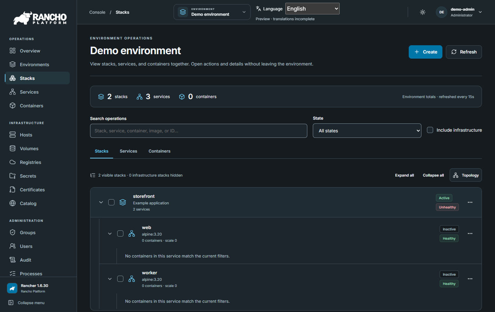

# Rancho Platform

<p align="center"></p>

**A modern Docker/Cattle console built on Rancher 1.6.30.** Operate containers in the context of their stack and environment, with logs, terminal, metrics and lifecycle actions close at hand.

**Choose your documentation language** · [🇺🇸 English](README.md) · [🇧🇷 Português (Brasil)](docs/pt-BR/overview.md)

[](https://github.com/lucaspaulukx/rancho-platform/releases)
[](https://github.com/lucaspaulukx/rancho-platform/actions/workflows/console-validation.yml)
[](LICENSE)

## Contents

- [What you can do](#what-you-can-do)
- [Install with Docker Compose](#install-with-docker-compose)
- [Compatibility and security](#compatibility-and-security)
- [Documentation](#documentation)



*English console running v0.1.0 in a local demo environment. [See the migration rehearsal](docs/en/migration-evidence.md).*

## What you can do

- **Operate workloads.** Browse environments, stacks, services and containers. Open logs, a terminal or metrics and run available actions from the same workspace.
- **Control access.** Manage local groups and assign permissions by environment. Connect an existing OIDC provider for sign-in. New users without grants see an access message.
- **Rehearse a migration.** Check the source database, take an encrypted backup and practice restore and rollback on an isolated copy.

## Install with Docker Compose

> [!WARNING]
> The published v0.1.0 is a preview. Stable status was withdrawn while language completion, visual acceptance and the remaining roadmap work are completed. Follow the [acceptance roadmap](docs/en/roadmap.md).

The [archived v0.1.0 preview](https://github.com/lucaspaulukx/rancho-platform-archive/releases/tag/v0.1.0) includes public images for Linux amd64. This quick start uses one Rancho server, MariaDB 10.11 and Docker Compose v2. Python 3.10+ runs the first administrator setup.

1. Check out the release.

   ```sh
   git clone --branch v0.1.0 --depth 1 https://github.com/lucaspaulukx/rancho-platform-archive.git
   cd rancho-platform
   ```

2. In the repository root, create a private `.env` file with `RANCHO_DB_PASSWORD` set to a strong, unique password. Then pull and start the stack.

   ```sh
   docker compose -f compose.modern.yaml -f compose.registry.yaml pull
   docker compose -f compose.modern.yaml -f compose.registry.yaml up -d --wait --no-build
   ```

3. On a **fresh database**, create the first local administrator. The script prompts for a password. Then open [the local console](http://localhost:18090/console/).

   ```sh
   python3 scripts/bootstrap_admin.py --origin http://localhost:18090 --username admin
   ```

[Pin images by digest](docs/en/release.md#install-prebuilt-release-images) or [configure an OIDC provider](docs/en/configuration.md#external-openid-connect-provider). If you already run Rancher 1.6, start with the [migration guide](docs/en/migration.md) and use the administrator from the restored database.

## Compatibility and security

The validated profile uses Linux amd64, a single server and Docker 29 Cattle hosts. The [roadmap](docs/en/roadmap.md) tracks acceptance for HA and in-place upgrades of existing IPsec stacks.

The v0.1.0 candidate scan reported **zero high or critical findings and zero detected secrets** across the 13 published images with the Trivy database used for that scan. The [security roadmap](docs/en/roadmap.md#beta-image-security-gate) records earlier scans, including 30 critical and 88 high findings on the legacy backend base. To report a vulnerability, follow the [security policy](SECURITY.md).

## Documentation

| I want to… | Read |
|---|---|
| Install and verify release images | [Release guide](docs/en/release.md) · [GHCR images](https://github.com/users/lucaspaulukx/packages/container/package/rancho-platform) |
| Move an existing Rancher installation | [Migration](docs/en/migration.md) · [Recovery](docs/en/recovery.md) |
| Set up OIDC, permissions or the console | [Configuration](docs/en/configuration.md) |
| Understand or contribute to the project | [Architecture](docs/en/architecture.md) · [Contributing](CONTRIBUTING.md) · [Testing](docs/en/testing.md) |

[English documentation index](docs/en/README.md) · [Índice em português](docs/pt-BR/README.md)

<details>
<summary>Build and test the frontend</summary>

With Node 24 installed, run:

```sh
cd console
npm ci
npm test
npm run build
```

For backend tests and comparison with classic Rancher, see the [sandbox testing guide](docs/en/testing.md).

</details>

Rancho Platform is an independent community project. Rancher and its contributors are credited for the upstream platform. [Apache-2.0 license](LICENSE) · [Notices](NOTICE)
