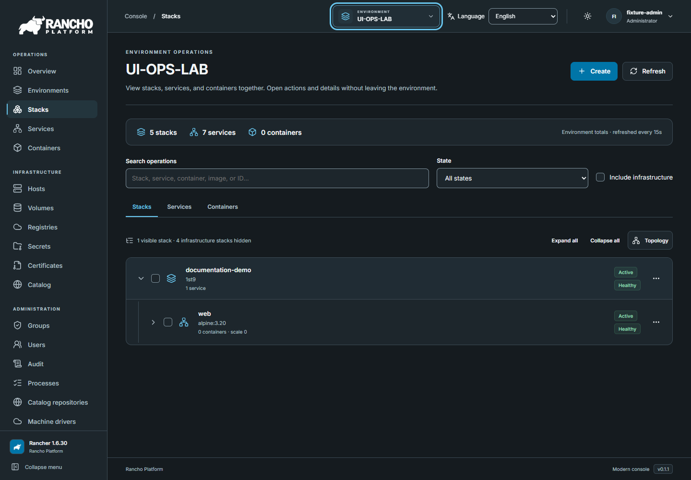
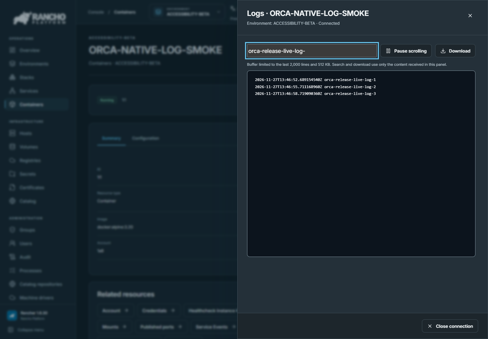

# Rancho frontend

[English](README.md) | [Português (Brasil)](../docs/pt-BR/console.md)

Independent React/TypeScript frontend using native Rancher1.6 APIs/session. Shared layouts, components, schemas, scoped mutations and themes are described in [architecture](../docs/en/architecture.md) and the [UI guide](../docs/en/ui-guidelines.md).

## Development

Run inside `console/`:

```sh
npm ci
npm run dev
npm test
npm run build
npm run format:check
```

Vite and the compose console both use port18090; run one frontend process at a time. Vite proxies local API/OIDC/WebSocket paths to the backend. Keep callbacks/public origin consistent; `vite.config.ts` and `nginx.conf` define each transport.

## Integration

`public/console-config.json` defines validated modules/themes; backend capabilities still govern authorization and compatible guards. See [configuration](../docs/en/configuration.md), [security](../docs/en/security-model.md) and [testing](../docs/en/testing.md).

Reuse the shell and contextual drawers. Preserve environment, URL filters and drafts. Never persist capabilities/credentials in browser storage or raw test evidence. Classic Ember remains unchanged; backend changes are exported as pinned patches.

## Acceptance

The Dockerfile installs the lockfile, runs frontend tests and builds TypeScript/Vite into nginx. Asset retention supports old tabs; final rollback/classic compatibility remains a release gate. Unit/component tests live in `src/test/`; native/browser harnesses in `tests/` require a documented dedicated sandbox.

Follow [contributing](../CONTRIBUTING.md) and maintain both languages. Dependencies, dist, fixture state and reports are generated, ignored data rather than source deliverables.

## Follow a workload through the console

Use a disposable environment with one stack named `documentation-demo` and a service named `web`. In **Operations → Stacks**, select that environment, search for the stack and expand it. A service at scale zero remains in the stack tree without starting a container. The **Services** tab shows the same service in the selected environment.



1. Open the service details from its actions menu.
2. Press Escape to close the drawer. Focus should return to the control that opened it.
3. Refresh the page. Verify that the URL still identifies the selected environment and the saved filters still apply where the view stores them.
4. To test real logs or the terminal, use a separate lab with a registered Docker host and a running container. The [testing guide](../docs/en/testing.md) describes the native workload checks.

### Inspect live container logs

In an environment with a registered host, open **Containers**, select a running container and choose **View logs** from its actions. Enter a fragment from your workload's output in **Filter logs**. The drawer keeps the container and environment in context. **Download** saves the portion retained in the browser buffer. Press Escape to close the drawer and return focus to the log action.



The capture shows real output from a disposable container on a Docker 29 test host. The workload emitted a new test line every three seconds.

Run `npm run check:locales` and `npm run check:ui-literals` after changing a visible label. The first checks the registered message catalogs. The second checks JSX text, interface properties and feedback calls. Consult the [UI guide](../docs/en/ui-guidelines.md) for keyboard, theme and layout checks.
