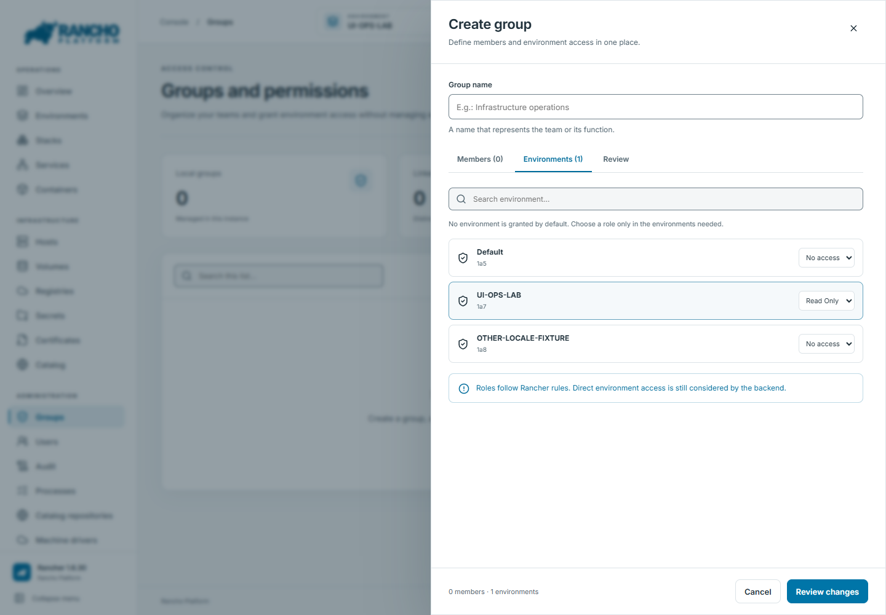

# Migrating direct access to local groups

<!-- rancho-language-navigation:start -->
[Português (Brasil)](../pt-BR/access-migration.md) | [English](access-migration.md)
<!-- rancho-language-navigation:end -->


## Preserve effective access

Existing direct environment membership remains valid alongside local groups. Do not import Keycloak-managed groups or infer identity from email/name. Global roles, unknown/dynamic providers, inactive/missing identities and unresolved role priorities need explicit review.

The read-only planner groups users only when their complete environment→role vectors are identical. It does not take a Cartesian product of different users' environments. Different roles/vectors never merge. Conflicting roles, unknown IDs or name collisions cannot silently create or overwrite a group. Native role priorities are configurable; effective server access, not a guessed fixed ordering, is the acceptance criterion.

## Private read-only plan

```sh
python -m migration.grants --source-container rancher-server --output migration-runs/grants-plan-001
```

Replace the source container and choose a new output directory. Supply a separate no-echo passphrase, minimum20 characters, or private `RANCHER_MIGRATION_BACKUP_PASSWORD`. `--defaults-file` points to an existing protected MySQL client file inside the source container; do not pass passwords on the command line.

The planner requires the supported MySQL/InnoDB schema and reads accounts, memberships and groups in one REPEATABLE READ consistent-snapshot transaction. It does not read passwords/certificates or write the source. IDs, external identities and group configuration stay in authenticated `groups-plan.enc`; summaries expose counts/reasons only.

The plan is coexistence-only: direct grants are unchanged and no public apply/remove/cutover command is provided. An empty proposal set is not a completed conversion. The plan is not a [recovery backup](recovery.md).

### Worked example with two environments

In a synthetic fixture, Alex and Sam each have the read-only role in one environment and the member role in another. The complete access vectors match, so the planner proposes one group, two members and two environment-role bindings. The summary should show these fields.

~~~json
{
  "proposedGroups": 1,
  "proposedMembers": 2,
  "proposedEnvironmentRoleBindings": 2,
  "sourceModified": false,
  "cutoverAccepted": false
}
~~~

If Alex and Sam have access to different environments, keep their access vectors separate. If the summary reports a conflict or a name collision, inspect the encrypted plan privately and resolve the underlying records before any change. The repository tests cover these three cases. [Access-planning fixtures](../../migration/test_grants.py)

The group editor shows where an administrator can draft a role binding for a single environment. Compare the selected environment and role with the plan before saving anything in the lab.



*The synthetic group has a draft environment role. The editor shows the proposed scope before the administrator saves it.*

## Coexistence and cutover design

Before any write, capture matching recovery state, revalidate baseline drift, backend capabilities, actors and environment scope. Use native APIs and audit, not direct UPDATE/DELETE of membership tables. Compare effective access for every affected identity/environment before and after coexistence, removal and rollback. Test allowed member writes, denied readonly/admin actions and revoked membership with positive controls.

The native `setmembers` action requires at least one owner in the direct-member list. A group owner does not satisfy that contract. Preserve a direct recovery owner per environment and never remove the last direct owner because a group exists.

Group revisions support conflict rejection; native membership-list updates do not provide equivalent atomic server CAS. A baseline comparison before POST does not protect the interval between GET and POST. Production automation needs exclusion/CAS or an enforced no-writer window. The isolated synthetic cutover harness is a test fixture, not a production migration command.

## Rollback

Restore direct memberships through native actions against the expected baseline. Remove only groups whose ownership/content/revision still match the operation; never overwrite concurrent changes or remove a subsequently edited group. Verify the complete effective-access matrix again, including global priorities and other groups.

If direct access was removed, restore and verify it before disabling local RBAC. Turning the group flag off first removes group-derived access. Keep matching [database/state/image recovery](recovery.md) and the unresolved concurrency/provider gates visible in the [roadmap](roadmap.md).
