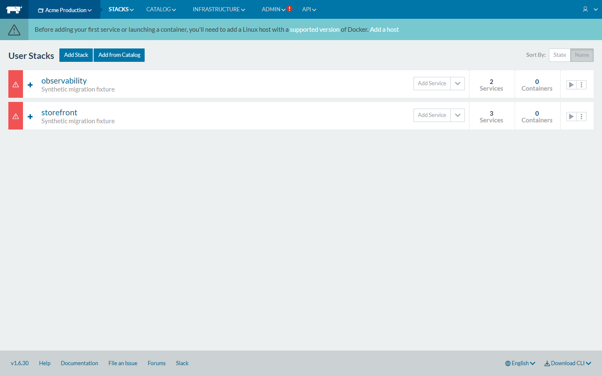
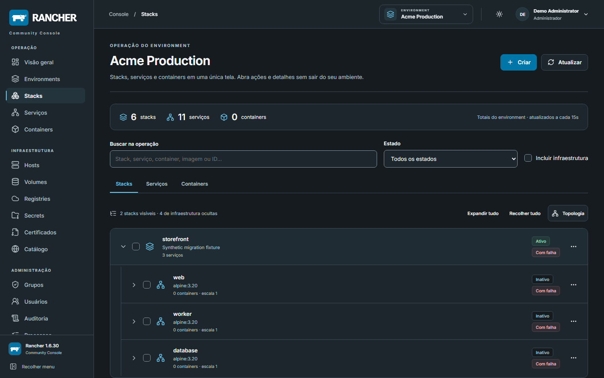

# Migration rehearsal with screenshots

<!-- rancho-language-navigation:start -->
[Português (Brasil)](../pt-BR/migration-evidence.md) | [English](migration-evidence.md)
<!-- rancho-language-navigation:end -->

The two screenshots show the same synthetic `Acme Production` environment before and after an automated SQL restore. The source was Rancher 1.6.30 with MySQL 5.5. The target used the modern Rancho backend, MariaDB 10.11 and the new Console.

## Before on Rancher 1.6.30

## After on Rancho

| Check | Before | After |
|---|---|---|
| Environment | Acme Production | Acme Production, same ID |
| Application stacks | observability, storefront | Same two stacks |
| Services | dashboard, metrics, database, web, worker | Same five services |
| Database | Original MySQL 5.5 | Sealed backup imported into MariaDB 10.11 |

The browser captures show the application inventory. The visual fixture used no workload VM. In the separate [persistent-volume rehearsal](migration.md#rehearsal-with-a-persistent-volume), the original agent reconnected after server migration. After upgrading that VM to Docker 29 and replacing the agent, Rancho recreated a removed workload container and the replacement read the same volume data.

The automated restore was also run twice on a separate synthetic backup. On the second startup, the restore image reported `already-applied`, and the environment ID and backend schema migration timestamp stayed the same. [Automated startup steps](migration.md#automated-restore-on-first-startup)
