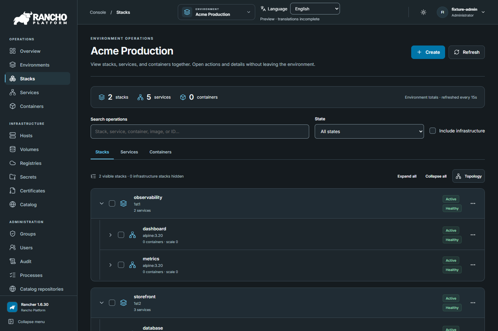

# Migration rehearsal with screenshots

<!-- rancho-language-navigation:start -->
[Português (Brasil)](../pt-BR/migration-evidence.md) | [English](migration-evidence.md)
<!-- rancho-language-navigation:end -->

The classic screenshot shows the original synthetic `Acme Production` inventory. The new Console screenshot comes from a repeat of the real sealed-backup migration using the same environment and application names on candidate `1ef1211`. The source was Rancher 1.6.30 with MySQL 5.5. The target used the modern Rancho backend, MariaDB 10.11 and the new Console.

## Before on Rancher 1.6.30

*Classic Rancher, **User Stacks**. The environment selector shows Acme Production. The two rows show two services in observability and three in storefront. Both rows show zero containers.*

## After on Rancho

*Rancho Console, **Stacks**. The selected environment is Acme Production. The summary shows two stacks, five services and zero containers. The expanded observability row shows dashboard and metrics, and the storefront header shows three services.*

| Check | Before | After |
|---|---|---|
| Environment | Acme Production | Acme Production, same ID |
| Application stacks | observability, storefront | Same two stacks |
| Services | dashboard, metrics, database, web, worker | Same five services |
| Database | Original MySQL 5.5 | Sealed backup imported into MariaDB 10.11 |

Compare the application rows and their service counts with the classic **User Stacks** view. Infrastructure provisioning was disabled in this repeat. The [earlier restored capture](../images/migration-after.png) also included four infrastructure stacks in the environment totals.

The browser captures show the application inventory. The visual fixture used no workload VM. In the separate [persistent-volume rehearsal](migration.md#rehearsal-with-a-persistent-volume), the original agent reconnected after server migration. After upgrading that VM to Docker 29 and replacing the agent, Rancho recreated a removed workload container and the replacement read the same volume data.

The automated restore was also run twice on a separate synthetic backup. On the second startup, the restore image reported `already-applied`, and the environment ID and backend schema migration timestamp stayed the same. [Automated startup steps](migration.md#automated-restore-on-first-startup)
