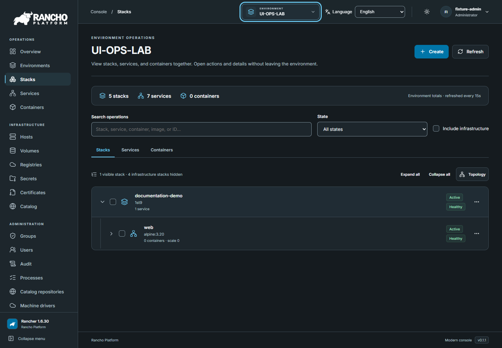

# Frontend practices

<!-- rancho-language-navigation:start -->
[Português (Brasil)](../pt-BR/ui-guidelines.md) | [English](ui-guidelines.md)
<!-- rancho-language-navigation:end -->

## Layout and identity

Use `AppShell` and `AuthLayout` in `console/src/layouts.tsx`. Authenticated pages share sidebar/navbar and environment context; login and no-access use the same visual language. With `branding` enabled, use the shared Rancho Platform bull lockup and the isolated bull for collapsed navigation and the favicon. The monochrome mark follows the Rancher blue palette and uses a white treatment on dark surfaces. Keep Rancher 1.6.30 attribution visible; disabling `branding` restores the original Rancher marks. New references to unrelated visual identities do not belong in the product.

The current shell uses a 224px sidebar, 80px collapsed width, 260px mobile panel and 767px breakpoint; navbar heights are 68px desktop and 72px mobile. Navigation scrolls inside its own region. Use the existing preference hook and accessibility state rather than duplicating navigation. Treat these values as current tokens/layout contracts and verify layout when changing them.

## Themes and controls

`console/src/themes/presets.json` is the palette source. Generate CSS through the existing theme script; do not hand-edit generated `tokens.css`. Rancher blue and neutral surfaces support dark/light/system modes and validated overrides. Apply theme tokens before paint; the existing transition handling avoids temporary unreadable color combinations.

Reuse `Field`, `CheckboxField`, buttons, menus, tables and modals from shared components. Associate labels, errors and descriptions with controls. Check native select options as well as the closed selector: foreground/background must remain readable in each theme. Target text contrast 4.5:1 and control contrast 3:1 on actual adjacent surfaces.

## Contextual operation

Keep stacks aligned vertically with services and containers, direct lifecycle controls and a `...` menu. Logs, terminal, metrics and configuration open within the same context. Preserve URL filters, environment and expansion state; avoid a new route for an action that fits the shared drawer. Reuse one stream connection when selecting a replica rather than opening a socket per selector change.

Respect native state/actions and permissions. Disabled controls explain their actual dependency; a hidden action is not a security boundary. Partial failures remain visible and do not erase drafts. Destructive or replacing operations use the shared review/confirmation components and explain the relevant impact.

## Forms and streaming data

Discover writable fields from current schemas. Use dedicated editors for supported contracts and keep an explicit native fallback. Invalid first edits must mark the form dirty, retain the typed value in memory and block submission; never silently round values or discard unknown legacy data.

Keep integer bounds and units explicit. Memory/reservation, CPU/IO, capabilities, health checks, sidecar dependencies and ulimits use their shared domain validators. Ulimits distinguish unlimited `-1`, explicit values and inherited/reset configuration; immutable fields on standalone containers require a different native operation.

Bound incoming frames and retained samples. Service metrics maintain independent per-container counters and series; unrelated identities are ignored. Display coverage and gaps honestly instead of presenting unsynchronized counters as a service total. Reset/close on identity or environment changes; permission closure must not start an automatic reconnect loop. CSV includes only the intended series and no capabilities.

## Rehearse a workspace change

*Capture from the synthetic lab with the shipped language selector. The header shows `UI-OPS-LAB`. The expanded `documentation-demo` stack and its `web` service at scale 0 appear in the workspace.*

In an isolated environment with a test stack and a running container:

1. Select the environment, open **Stacks**, expand a stack and search by service name. Open the container's **…** menu and choose its logs. Confirm that the log panel appears within the workspace and the environment and search stay in context.
2. Close the panel with **Escape**. Verify that focus returns to the control that opened it. Use **Tab** to move through the environment selector, search, active view tab and menus. Move between view tabs with the horizontal arrow keys. At 320 px, confirm the page fits and the mobile sidebar can be dismissed with **Escape**.
3. Switch between dark and light themes with the search populated. In a deployment with the [language policy](configuration.md#interface-language-policy), change the language while a draft is open. Confirm the draft and environment selection are preserved. In Persian, verify that the layout mirrors while terminal and Compose source stay left-to-right. Compare the layout at 320 px with the [Persian mobile capture](../images/guide-workloads-fa-IR-mobile.png).
4. With an account that only has read access, verify the available actions. Use a disposable writer account to exercise save and cancellation in a draft. Check that the backend denies a write by the reader even if the client tries to issue it.

Record the image revision, locale, viewport and theme beside any screenshot from the exercise. See the [testing guide](testing.md) for the automated and native checks.

## Acceptance

Verify desktop/mobile, keyboard focus/return, loading/empty/error/partial states, both themes, dirty-draft behavior and cleanup. Unit tests and axe do not replace manual screen-reader review, high-volume measurement or actual native effects. Keep incomplete gates in the [roadmap](roadmap.md), with feature defaults documented in [configuration](configuration.md).
