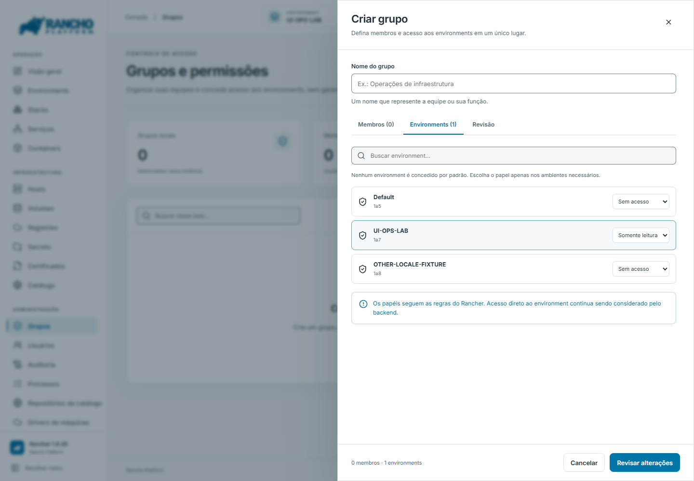

# Migração de acessos diretos para grupos locais

<!-- rancho-language-navigation:start -->
[Português (Brasil)](access-migration.md) | [English](../en/access-migration.md)
<!-- rancho-language-navigation:end -->


## Preserve o acesso efetivo

Associações diretas existentes permanecem válidas junto de grupos locais. Não importe grupos administrados pelo Keycloak nem infira identidade por email/nome. Papéis globais, providers desconhecidos/dinâmicos, identidades inativas/ausentes e prioridades não resolvidas exigem revisão explícita.

O planner somente leitura agrupa usuários apenas quando seus vetores completos environment→papel são idênticos. Não cria produto cartesiano dos environments de usuários diferentes. Vetores/papéis distintos não são unidos. Conflitos, IDs desconhecidos e colisões de nomes não criam/substituem grupos silenciosamente. Prioridades nativas são configuráveis; o aceite usa acesso efetivo do servidor, não hierarquia fixa presumida.

## Plano privado somente leitura

```sh
python -m migration.grants --source-container rancher-server --output migration-runs/grants-plan-001
```

Substitua o container e use diretório novo. Forneça senha separada sem eco, mínimo20 caracteres, ou secret privado `RANCHER_MIGRATION_BACKUP_PASSWORD`. `--defaults-file` aponta para arquivo MySQL protegido já existente dentro da origem; não passe senhas na linha de comando.

O planner exige schema MySQL/InnoDB suportado e lê contas, membros e grupos na mesma transação REPEATABLE READ com consistent snapshot. Não lê senhas/certificados nem escreve na origem. IDs, identidades externas e configuração ficam no `groups-plan.enc` autenticado; resumos expõem apenas contagens/motivos.

O plano é somente coexistência: grants diretos não mudam e não existe comando público apply/remove/cutover. Plano vazio não é conversão concluída. O plano não substitui [backup de recuperação](recovery.md).

### Exemplo com dois ambientes

No cenário sintético, Alex e Sam têm o papel de leitura em um ambiente e o papel de membro em outro. Os conjuntos completos de acesso coincidem, então o planejador propõe um grupo, dois membros e dois vínculos entre ambiente e papel. O resumo deve apresentar estes campos.

~~~json
{
  "proposedGroups": 1,
  "proposedMembers": 2,
  "proposedEnvironmentRoleBindings": 2,
  "sourceModified": false,
  "cutoverAccepted": false
}
~~~

Se Alex e Sam têm acesso a ambientes diferentes, mantenha os conjuntos de acesso separados. Se o resumo apresentar conflito ou colisão de nome, examine o plano criptografado em privado e resolva os registros envolvidos antes de qualquer alteração. Os testes do repositório cobrem esses três casos. [Cenários de teste do planejamento de acesso](../../migration/test_grants.py)

O editor de grupos mostra onde o administrador pode preparar um vínculo de papel para um único ambiente. Compare o ambiente e o papel selecionados com o plano antes de salvar qualquer alteração no laboratório.



*O grupo sintético tem um papel de ambiente em edição. O editor mostra o escopo proposto antes de o administrador salvar.*

## Desenho de coexistência e cutover

Antes de escrever, capture recuperação correspondente e revalide drift, capacidades do backend, atores e escopo. Use APIs nativas/auditoria, não UPDATE/DELETE direto em tabelas de membros. Compare acesso efetivo de cada identidade/environment antes/depois de coexistência, retirada e rollback. Teste escrita permitida como member, negações readonly/admin e revogação de associação, com controles positivos.

`setmembers` exige ao menos um owner na lista de membros diretos. Owner por grupo não satisfaz esse contrato. Preserve owner direto de recuperação por environment; não retire o último owner direto por existir grupo.

Revisões de grupo rejeitam conflitos; atualizações de listas nativas não oferecem CAS atômico equivalente. Comparação antes do POST não protege o intervalo GET→POST. Automação produtiva exige exclusão/CAS ou janela sem outros escritores. O harness sintético isolado de cutover é fixture, não comando de migração produtiva.

## Rollback

Restaure membros diretos por ações nativas contra baseline esperado. Remova só grupos cujo ownership/conteúdo/revisão ainda correspondam à operação; não sobrescreva concorrência nem remova grupo editado depois. Confira toda a matriz efetiva novamente, incluindo prioridades globais e outros grupos.

Se diretos foram retirados, restaure e confira antes de desligar RBAC local. Desligar a flag primeiro retira acesso por grupo. Mantenha [recuperação de banco/estado/imagem](recovery.md) correspondente e gates pendentes de concorrência/providers no [roadmap](roadmap.md).
