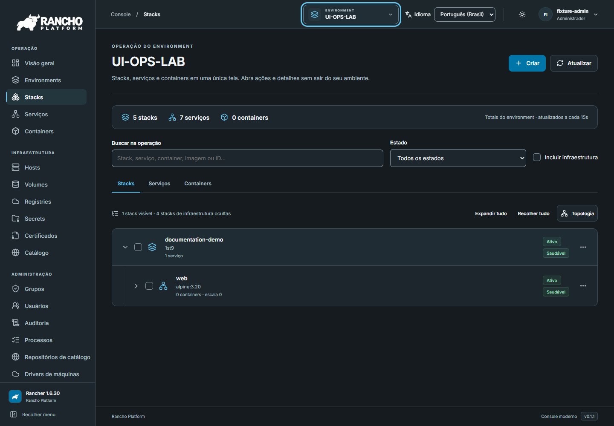
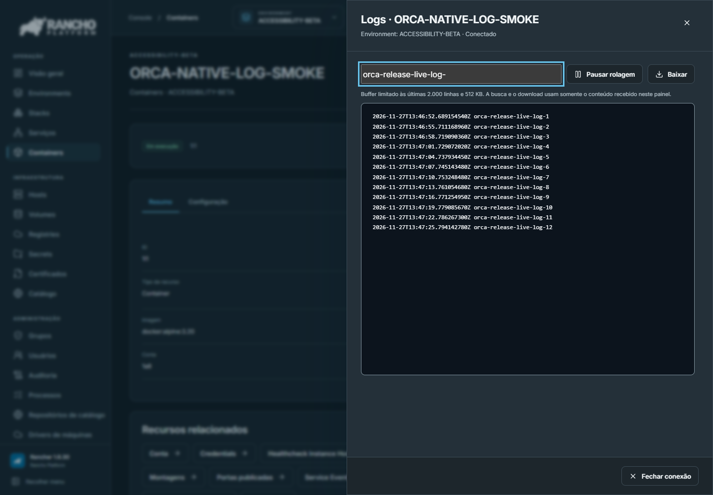

# Frontend Rancho

[Português (Brasil)](console.md) | [English](../../console/README.md)

Frontend independente React/TypeScript usando APIs/sessão nativas Rancher1.6. Layouts, componentes, schemas, mutações no escopo e temas são descritos em [arquitetura](architecture.md) e [UI](ui-guidelines.md).

## Desenvolvimento

Execute em `console/`:

```sh
npm ci
npm run dev
npm test
npm run build
npm run format:check
```

Vite e console Compose usam porta18090; execute um frontend por vez. Vite encaminha API/OIDC/WebSocket ao backend local. Mantenha callback/origem coerentes; `vite.config.ts` e `nginx.conf` definem o transporte de cada modo.

## Integração

`public/console-config.json` define módulos/temas validados; capacidades do backend continuam impondo autorização e guardas compatíveis. Veja [configuração](configuration.md), [segurança](security-model.md) e [testes](testing.md).

Reuse shell e drawers contextuais. Preserve environment, filtros e rascunhos. Não persista capacidades/credenciais em storage ou evidência bruta. Ember permanece intacto; mudanças backend viram patches pinados.

## Aceite

O Dockerfile instala o lockfile, testa o frontend e faz build TypeScript/Vite para nginx. Retenção de assets suporta abas antigas; rollback final/compatibilidade clássica continuam gates. Unitários/componentes ficam em `src/test/`; harnesses nativos/browser em `tests/` exigem sandbox dedicado documentado.

Siga [contribuição](contributing.md) e mantenha os dois idiomas. Dependências, dist, estado de fixtures e relatórios são dados gerados/ignorados, não fontes entregáveis.

## Acompanhe um workload pelo console

Use um environment descartável com uma stack chamada `documentation-demo` e um serviço chamado `web`. Em **Operações → Stacks**, selecione esse environment, busque a stack e expanda a linha. Um serviço com escala zero aparece na árvore da stack sem iniciar um container. A aba **Serviços** mostra o mesmo serviço no environment selecionado.



1. Abra os detalhes do serviço pelo menu de ações.
2. Pressione Escape para fechar o painel. O foco deve voltar ao controle que o abriu.
3. Recarregue a página. Confira se a URL mantém o environment selecionado e se a busca e os filtros continuam aplicados nas telas que os guardam.
4. Para testar logs ou o terminal de verdade, use um laboratório separado com um host Docker registrado e um container em execução. O [guia de testes](testing.md) descreve as verificações com workloads reais.

### Consulte os logs ao vivo do container

Em um environment com um host registrado, abra **Containers**, selecione um container em execução e escolha **Ver logs** nas ações. Digite um trecho da saída do workload em **Filtrar logs**. O painel mantém o container e o environment no contexto. **Baixar** salva a parte retida no buffer do navegador. Pressione Escape para fechar o painel e devolver o foco à ação de logs.



A captura mostra a saída real de um container descartável em um host Docker 29 de teste. O workload emitia uma linha de teste a cada três segundos.

Execute `npm run check:locales` e `npm run check:ui-literals` após alterar um rótulo visível. O primeiro verifica os catálogos de mensagens registradas. O segundo verifica textos em JSX, propriedades da interface e chamadas de feedback. Consulte as [boas práticas de frontend](ui-guidelines.md) para verificar teclado, temas e layout.
