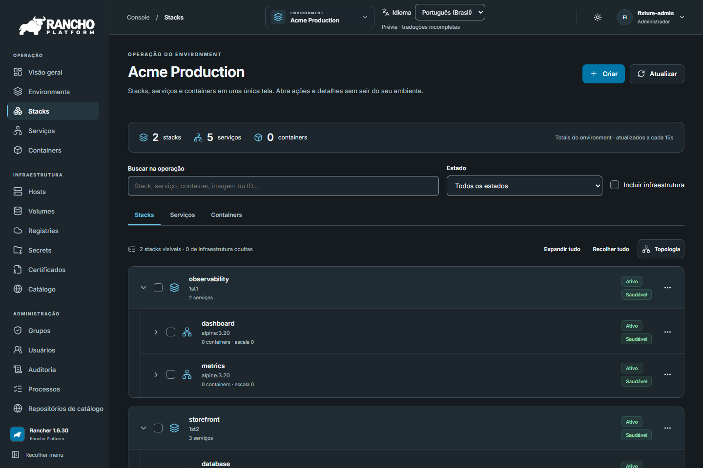

# Ensaio de migração com capturas de tela

<!-- rancho-language-navigation:start -->
[Português (Brasil)](migration-evidence.md) | [English](../en/migration-evidence.md)
<!-- rancho-language-navigation:end -->

A captura do Rancher clássico mostra o inventário sintético original de `Acme Production`. A captura do console novo veio de uma repetição da migração real com backup selado na candidata `1ef1211`, usando os mesmos nomes de environment e aplicações. A origem era Rancher 1.6.30 com MySQL 5.5. O destino usou o backend moderno do Rancho, MariaDB 10.11 e a nova Console.

## Antes no Rancher 1.6.30

[Veja a captura original do Rancher clássico com as stacks observability e storefront (English)](../images/migration-before.png).

*Rancher clássico, tela **User Stacks**. O seletor mostra Acme Production. As duas linhas mostram dois serviços em observability e três em storefront. As duas stacks têm zero containers.*

## Depois no Rancho

*Console Rancho, tela **Stacks**. O environment selecionado é Acme Production. O resumo mostra duas stacks, cinco serviços e zero containers. A linha expandida de observability mostra dashboard e metrics, e o cabeçalho de storefront indica três serviços.*

| Verificação | Antes | Depois |
|---|---|---|
| Environment | Acme Production | Acme Production, mesmo ID |
| Stacks de aplicação | observability, storefront | As mesmas duas stacks |
| Serviços | dashboard, metrics, database, web, worker | Os mesmos cinco serviços |
| Banco de dados | MySQL 5.5 original | Backup selado importado no MariaDB 10.11 |

Compare as linhas das aplicações e as contagens de serviços com a tela **User Stacks** do Rancher clássico. O provisionamento de infraestrutura ficou desativado nesta repetição. A [captura anterior da restauração](../images/migration-after.png) incluía quatro stacks de infraestrutura nos totais do environment.

As capturas mostram o inventário de aplicações. O ensaio visual usou apenas o servidor. No [ensaio separado com volume persistente](migration.md#ensaio-com-volume-persistente), o agente original reconectou após a migração do servidor. Depois de atualizar a VM para Docker 29 e substituir o agente, o Rancho recriou um container removido e o substituto leu os mesmos dados do volume.

A restauração automática também foi executada duas vezes com outro backup sintético. Na segunda inicialização, a imagem registrou `already-applied`, e o ID do environment e a data da migração de schema permaneceram iguais. [Passos da inicialização automática](migration.md#restauração-automática-no-primeiro-início)
