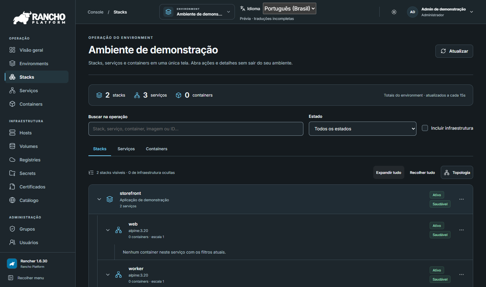

# Rancho Platform

<p align="center"></p>

**Um console moderno para Docker/Cattle, baseado no Rancher 1.6.30.** Gerencie containers no contexto da stack e do ambiente, com logs, terminal, métricas e ações ao alcance.

[🇧🇷 Português (Brasil)](overview.md) · [🇺🇸 English](../../README.md)

[](https://github.com/lucaspaulukx/rancho-platform/releases/latest)
[](https://github.com/lucaspaulukx/rancho-platform/actions/workflows/console-validation.yml)
[](../../LICENSE)

[Instalação](#instale-com-docker-compose) · [Migração do Rancher](migration.md) · [Imagens no GHCR](https://github.com/users/lucaspaulukx/packages/container/package/rancho-platform) · [Documentação](#documentação)



*Console em português com dados de demonstração. [Veja o ensaio de migração](migration-evidence.md).*

## O que você pode fazer

- **Operar workloads.** Navegue por ambientes, stacks, serviços e containers. Abra logs, terminal e métricas ou execute as ações disponíveis na mesma tela.
- **Controlar o acesso.** Gerencie grupos locais e conceda permissões por ambiente. Conecte um provedor OIDC existente para o login. Novos usuários sem permissões veem uma mensagem de acesso.
- **Ensaiar uma migração.** Verifique o banco de origem, faça um backup criptografado e teste a restauração e o rollback em uma cópia isolada.

## Instale com Docker Compose

A [versão v0.1.0](https://github.com/lucaspaulukx/rancho-platform/releases/tag/v0.1.0) inclui imagens públicas para Linux amd64. Este início rápido usa um servidor Rancho, MariaDB 10.11 e Docker Compose v2. A criação do primeiro administrador usa Python 3.10+.

1. Faça checkout da versão.

   ```sh
   git clone --branch v0.1.0 --depth 1 https://github.com/lucaspaulukx/rancho-platform.git
   cd rancho-platform
   ```

2. Na raiz do repositório, crie um arquivo `.env` privado e defina `RANCHO_DB_PASSWORD` com uma senha forte e exclusiva. Baixe as imagens e suba os serviços.

   ```sh
   docker compose -f compose.modern.yaml -f compose.registry.yaml pull
   docker compose -f compose.modern.yaml -f compose.registry.yaml up -d --wait --no-build
   ```

3. Em um **banco novo**, crie o primeiro administrador local. O script pede a senha. Depois, abra o [console local](http://localhost:18090/console/).

   ```sh
   python3 scripts/bootstrap_admin.py --origin http://localhost:18090 --username admin
   ```

[Fixe as imagens por digest](release.md#instalar-imagens-prontas-de-uma-release) ou [configure um provedor OIDC](configuration.md#provedor-openid-connect-externo). Se você já usa Rancher 1.6, comece pelo [guia de migração](migration.md) e use o administrador do banco restaurado.

## Compatibilidade e segurança

O perfil validado usa Linux amd64, um servidor e hosts Cattle com Docker 29. O [roadmap](roadmap.md) acompanha o aceite de alta disponibilidade e da atualização direta de stacks IPsec existentes.

A varredura da candidata à v0.1.0 reportou **zero achados altos ou críticos e zero segredos detectados** nas 13 imagens publicadas com a base Trivy usada no teste. O [roadmap de segurança](roadmap.md#segurança-das-imagens-para-a-beta) registra as varreduras anteriores, incluindo 30 achados críticos e 88 altos na base legada do backend. Para reportar uma vulnerabilidade, siga a [política de segurança](security.md).

## Documentação

| Quero… | Consulte |
|---|---|
| Instalar e verificar imagens de uma release | [Guia de release](release.md) |
| Migrar uma instalação existente do Rancher | [Migração](migration.md) · [Recuperação](recovery.md) |
| Configurar OIDC, permissões ou o console | [Configuração](configuration.md) |
| Conhecer o projeto ou contribuir | [Arquitetura](architecture.md) · [Contribuição](contributing.md) · [Testes](testing.md) |

[Índice em português](README.md) · [English documentation index](../en/README.md)

<details>
<summary>Compilar e testar o frontend</summary>

Com Node 24 instalado, execute:

```sh
cd console
npm ci
npm test
npm run build
```

Para testar o backend ou comparar com o Rancher clássico, consulte o [guia de testes em ambiente isolado](testing.md).

</details>

O Rancho Platform é um projeto comunitário independente. O Rancher e seus contribuidores recebem o crédito pela plataforma original. [Licença Apache-2.0](../../LICENSE) · [Avisos de licença](../../NOTICE)
