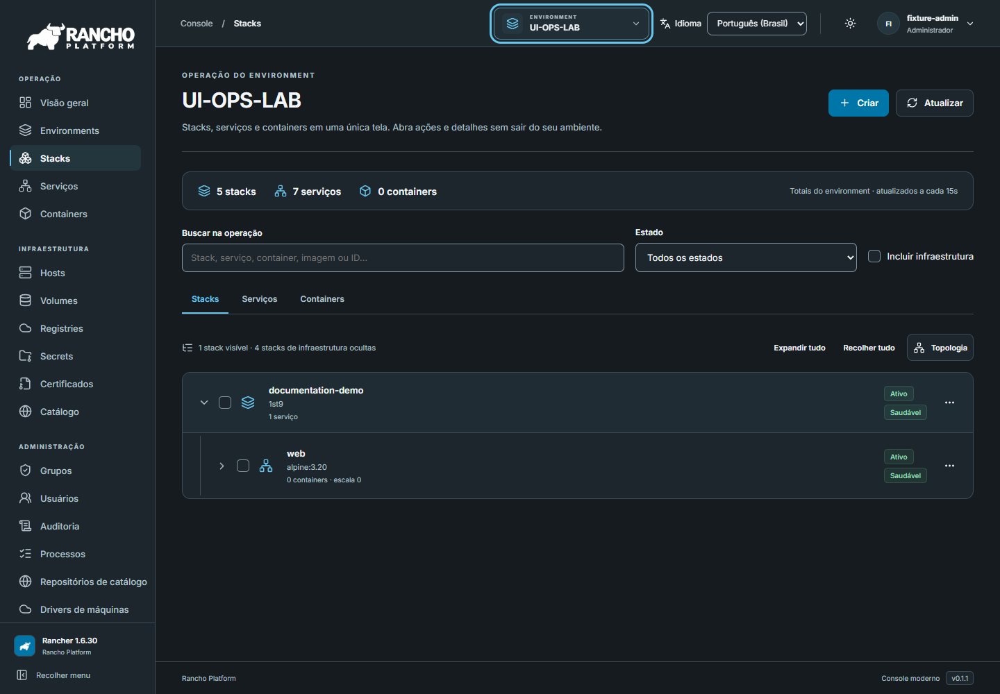

# Boas práticas de frontend

<!-- rancho-language-navigation:start -->
[Português (Brasil)](ui-guidelines.md) | [English](../en/ui-guidelines.md)
<!-- rancho-language-navigation:end -->

## Layout e identidade

Use `AppShell` e `AuthLayout` em `console/src/layouts.tsx`. Páginas autenticadas compartilham sidebar/navbar e contexto de environment; login e sem-acesso usam a mesma linguagem visual. Com `branding` ativado, use a composição compartilhada do touro com Rancho Platform e o touro isolado na navegação recolhida e no favicon. A marca monocromática acompanha a paleta azul Rancher e fica branca nas superfícies escuras. Preserve a atribuição ao Rancher 1.6.30; desativar `branding` restaura as marcas originais Rancher. Referências a identidades visuais alheias não pertencem ao produto.

O shell atual usa sidebar224px, recolhida80px, painel móvel260px e breakpoint767px; navbar68px no desktop e72px no móvel. A navegação rola em sua própria região. Use o hook de preferência e estados acessíveis existentes, sem duplicar navegação. Trate medidas como contratos atuais de tokens/layout e confira o layout ao alterá-las.

## Temas e controles

`console/src/themes/presets.json` é a fonte das paletas. Gere CSS pelo script existente, sem editar `tokens.css` gerado manualmente. Azul Rancher e superfícies neutras suportam modos escuro/claro/sistema e overrides validados. Aplique tokens antes da pintura; o tratamento existente evita combinações temporariamente ilegíveis durante a troca.

Reuse `Field`, `CheckboxField`, botões, menus, tabelas e modais compartilhados. Associe rótulos, erros e descrições aos controles. Confira opções nativas do select além do seletor fechado: texto/fundo devem permanecer legíveis em cada tema. Busque contraste4.5:1 para texto e3:1 para controles nas superfícies adjacentes reais.

## Operação contextual

Mantenha stacks alinhadas verticalmente com serviços/containers, controles diretos de lifecycle e menu `...`. Logs, terminal, métricas e configuração abrem no mesmo contexto. Preserve filtros da URL, environment e expansões; evite criar rota para ação que cabe no drawer comum. Reuse a conexão de stream ao selecionar uma réplica, em vez de abrir socket por troca do seletor.

Respeite estados/ações nativos e permissões. Controles desativados explicam a dependência real; esconder ação não impõe segurança. Falhas parciais ficam visíveis e não apagam rascunhos. Operações destrutivas ou que substituem containers usam revisão/confirmação comuns e explicam o impacto pertinente.

## Formulários e dados de stream

Descubra campos graváveis nos schemas atuais. Use editores dedicados para contratos suportados e fallback nativo explícito. A primeira edição inválida deve marcar o formulário alterado, manter o texto em memória e bloquear envio; não arredonde valores ou descarte dados legados desconhecidos silenciosamente.

Explicite limites inteiros e unidades. Memória/reserva, CPU/IO, capabilities, saúde, dependências de sidecars e ulimits usam validadores de domínio comuns. Ulimits distinguem `-1` ilimitado, valores explícitos e configuração herdada/reset; campos imutáveis de containers avulsos exigem outra operação nativa.

Limite frames de entrada e amostras retidas. Métricas de serviço mantêm contadores/séries independentes por container; identidades alheias são ignoradas. Mostre cobertura e lacunas sem chamar contadores dessincronizados de total do serviço. Troca de identidade/environment reinicia/fecha o painel; encerramento por permissão não inicia loop de reconexão. CSV contém somente as séries desejadas, sem capacidades.

## Ensaie uma mudança na tela de workloads

*Captura do laboratório sintético com o seletor de idiomas distribuído. O cabeçalho mostra `UI-OPS-LAB` e a tela exibe a stack `documentation-demo` expandida e seu serviço `web` em escala 0.*

Em um ambiente isolado com uma stack de teste e um container em execução:

1. Selecione o ambiente, abra **Stacks**, expanda uma stack e busque pelo nome do serviço. Abra o menu **…** do container e escolha os logs. Confirme que o painel abre na mesma tela e mantém o contexto do ambiente e da busca.
2. Feche o painel com **Escape**. Verifique se o foco retorna ao controle que o abriu. Use **Tab** para percorrer o seletor de ambiente, a busca, a aba ativa e os menus. Use as setas horizontais para mudar de aba. Em 320 px, confira se a página cabe na tela e se **Escape** fecha a navegação móvel.
3. Alterne entre os temas claro e escuro com a busca preenchida. Em uma implantação com a [política de idiomas](configuration.md#política-de-idiomas-da-interface), troque o idioma com um rascunho aberto. Confirme se o rascunho e o ambiente selecionado foram preservados. Em persa, confira se o layout é espelhado e se o terminal e o código Compose continuam da esquerda para a direita. Compare o layout em 320 px com a [captura móvel em persa](../images/guide-workloads-fa-IR-mobile.png).
4. Com uma conta que só tem acesso de leitura, verifique as ações oferecidas. Use uma conta temporária com permissão de escrita para testar salvamento e cancelamento de um rascunho. Confira se o backend recusa uma operação de escrita do leitor mesmo que o cliente tente enviá-la.

Registre a revisão da imagem, o idioma, o tamanho da janela e o tema ao lado de cada captura do ensaio. Consulte o [guia de testes](testing.md) para as verificações automatizadas e nativas.

## Aceite

Verifique desktop/móvel, foco/retorno por teclado, loading/vazio/erro/parcial, os dois temas, proteção de rascunhos e cleanup. Unitários e axe não substituem leitor de tela manual, medição em alto volume ou efeitos nativos reais. Mantenha gates incompletos no [roadmap](roadmap.md), com defaults em [configuração](configuration.md).
